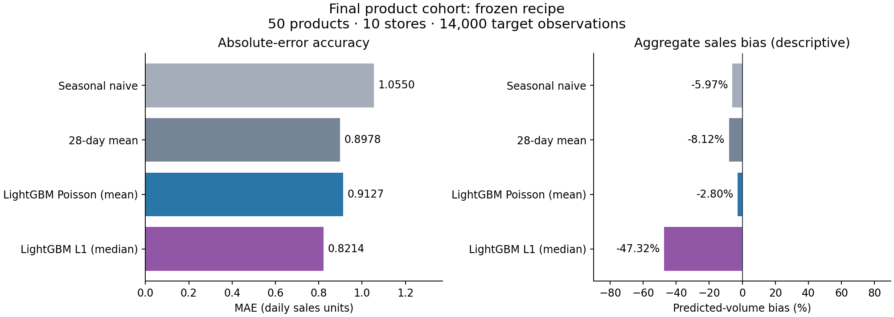

# DemandCast

Daily retail sales forecasting with LightGBM, temporal backtesting and a local
forecast-review dashboard. DemandCast makes a practical distinction between
median forecasts for absolute-error accuracy, mean forecasts for expected sales
and prediction intervals for uncertainty.

The development benchmark uses a fixed sample of 500 M5 item/store series,
730 history days and a 28-day forecast horizon. Development validation and a separately preregistered product-cohort evaluation
are reported separately below.

## Development validation

Point forecasts use the same 42,000 observations across three validation windows:

| Model | MAE | WAPE | Aggregate predicted-sales bias |
| --- | ---: | ---: | ---: |
| LightGBM L1, median-oriented | **0.9561** | **70.45%** | -34.50% |
| LightGBM Poisson, mean-oriented | 1.0588 | 78.01% | -3.70% |
| 28-day mean | 1.0554 | 77.76% | -0.55% |
| Seasonal naive | 1.2530 | 92.32% | -2.88% |

L1 reduces pooled MAE by 9.41% relative to the 28-day mean and by 9.70% relative
to Poisson. It also predicts substantially less aggregate sales. This is a
tradeoff between forecasting targets; the dashboard presents both estimates.

The q10-q90 envelope and the temporal correction have identical results on the
same 28,000 observations from the two later windows:

| Interval measure | Value |
| --- | ---: |
| Inclusive observed coverage | 89.36% |
| Mean width | 3.003 daily sales units |
| 80% interval score, lower is better | 4.460 |
| Below lower bound | 0.60% |
| Above upper bound | 10.04% |
| All six temporal corrections | 0 |

The uncalibrated envelope is retained as the demo default. The neutral
calibration result is part of the experiment record. Nominal 80% is a target,
not a guarantee; discrete sales and ties can give higher inclusive coverage.

Sources: the preserved E02/E03 receipts and CSV summaries under
[`reports/dashboard_reference`](reports/dashboard_reference). See the
[experiment log](docs/release/EXPERIMENTS.md) and
[development model card](docs/MODEL_CARD_V02.md) for scope and limitations.

## Quickstart

Use Python 3.12 or 3.13. From an assembled DemandCast checkout:

```bash
python -m venv .venv
# Windows PowerShell: .venv\Scripts\Activate.ps1
# Linux/macOS: source .venv/bin/activate
python -m pip install -r requirements-release.txt -e .
python -m streamlit run dashboard/app.py
```

The dashboard opens at `http://localhost:8501`. Its bundled validation summaries
work without raw M5 data. Series-level review uses your E02
`outputs/interval-validation/interval_predictions.csv`; a matching E03 file
hash is required. The interface offers interval review, predicted-demand
segments, point-model comparison and per-series forecast exploration.

## Reproduce the M5 experiments

Obtain the M5 files separately and follow the
[original core preparation instructions](docs/release/CORE_SETUP_ORIGINAL.md)
to create `data/processed/m5.csv`. The ablation scripts require the frozen
development panel and `configs/m5.yaml`; they stop on mismatched source data,
settings or reference results. Raw data and generated prediction files are
excluded from the repository.

```bash
python experiments/run_l1_ablation.py --data data/processed/m5.csv --config configs/m5.yaml --output outputs/l1-validation
python experiments/run_interval_benchmark.py --data data/processed/m5.csv --config configs/m5.yaml --output outputs/interval-validation
python experiments/run_temporal_calibration.py --input-dir outputs/interval-validation --output outputs/calibration-validation
```

The third command reuses saved predictions and does not train models. See
[reproducibility](docs/release/REPRODUCIBILITY.md) for configuration, split dates,
source hashes and the distinction between the three-window point benchmark and
the two-window calibration replay.

## Tests and CI

```bash
python scripts/project_preflight.py --output reports/release/project-preflight.json
python -m pytest -q tests
```

[CI](.github/workflows/ci.yml) is configured for Ubuntu with Python 3.12/3.13
and Windows with Python 3.13. It installs this checkout, checks its core
interfaces and frozen reference summaries, and runs the core and addon tests.
M5 downloads and full model-training benchmarks remain separate from CI.
The workflow's actual result appears in GitHub Actions after a push or PR;
this README does not claim an unobserved remote CI result.

## Final product-cohort evaluation

The frozen recipe was retrained on 50 products outside the development sample,
across all 10 stores. It uses 702 observed days through 2016-04-24 and
14,000 target observations over 2016-04-25 to 2016-05-22.

| Model | MAE | WAPE | Aggregate predicted-sales bias |
| --- | ---: | ---: | ---: |
| Seasonal naive | 1.0550 | 103.46% | -5.97% |
| 28-day mean | 0.8978 | 88.04% | -8.12% |
| LightGBM Poisson (mean) | 0.9127 | 89.50% | -2.80% |
| LightGBM L1 (median) | 0.8214 | 80.55% | -47.32% |



| Interval measure | Value |
| --- | ---: |
| Inclusive envelope coverage | 89.85% |
| Mean width | 2.4139 sales units |
| 80% interval score | 3.7643 |
| Below lower / above upper | 0.00% / 10.15% |

The interval is the frozen q10/L1/q90 envelope without temporal expansion.
Compare models on these same targets. Development and final-cohort absolute
scores use different products and are not a paired before/after improvement.
L1 remains median-oriented and Poisson remains mean-oriented; volume bias is
shown separately from absolute error.

This is a product-disjoint recipe check with shared calendar/store conditions,
not an independent dataset, zero-shot transfer or a significance claim.
The final outcomes have now been inspected; further tuning needs a new plan.

Sources and original receipts: [final reference](reports/final_cohort_reference).
The [registered protocol](docs/release/FINAL_EVALUATION_PROTOCOL.md) and
[runner contract](docs/release/FINAL_EVALUATION_RUNNER.md) explain the dates and guards.

To reproduce on separately obtained M5 inputs, register before scoring:

```bash
python scripts/register_final_evaluation.py
python experiments/run_final_evaluation.py --phase forecast
python experiments/run_final_evaluation.py --phase score
```

## Repository layout

| Path | Purpose |
| --- | --- |
| `src/demandcast` or `demandcast` | Original preparation, feature and forecasting package |
| `experiments` | Frozen objective, quantile and temporal-calibration experiments |
| `dashboard` | Streamlit app and source validation |
| `analysis`, `notebooks` | Reproducible diagnostic code and exploration |
| `configs` | Experiment configuration |
| `tests` | Core, model-component and interaction checks |
| `reports/*_reference` | Small reproducibility receipts and aggregate summaries |
| `docs/release` | Experiments, reproduction and final-evaluation protocol |

## Scope

This is a sampled M5 development benchmark, not an official full hierarchical
WRMSSE leaderboard result. Observed unit sales are not a measured inventory
service level or lost-demand estimate. Only three development windows have
been inspected, and descriptive improvements are not statistical-significance
claims. See the model card for the known selection and dependence limitations.

Method references: [CQR](https://arxiv.org/abs/1905.03222),
[forecast evaluation](https://otexts.com/fpp3/toolbox.html),
[LightGBM objectives](https://lightgbm.readthedocs.io/en/stable/Parameters.html).
